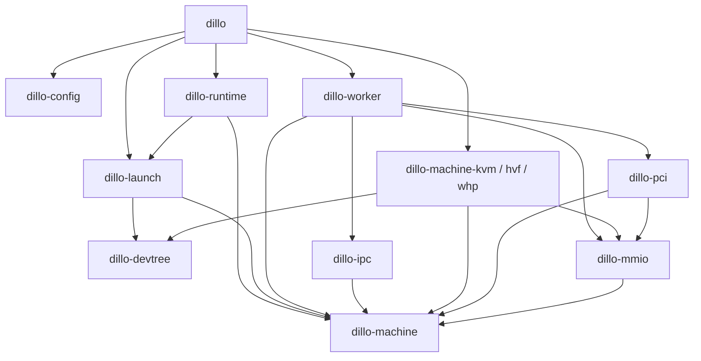

# Dillo design

## Threat model

### THREAT-001 — Treat the host and guest as mutually adversarial

Dillo is intentionally designed for a mutually adversarial host and guest.
Neither party is assumed to trust the other. The goal is to make it easy to
protect the host from a malicious guest and the guest from a malicious host.

Host protection requires treating guest inputs and device activity as
untrusted, limiting component authority and resource use, isolating device
execution, and failing safely. Guest protection must not depend on the host
running an honest Dillo implementation.

### THREAT-002 — Require confidential computing for guest protection

Protecting the guest from a malicious host requires a confidential-computing
target, such as SEV-SNP, and its memory-protection and attestation mechanisms.
An ordinary `vm` target does not provide that protection. Attestation must be
appraised against the expected image, measured inputs, and security policy;
measurement alone does not establish that supplied content is trustworthy.

Unmeasured host inputs remain untrusted and must be constrained and validated
as required by PMI. A conformant-host requirement cannot replace guest or
verifier enforcement against a malicious host. The host can still deny service
by refusing to run or stopping the guest.

### THREAT-003 — Use PMI as the explicit launch and platform contract

PMI exists to make the guest's launch requirements and platform definition
explicit and portable across targets, with defined measurement and validation
rules. The image specifies the machine; the host realizes it or refuses the
launch. Host choices are limited to the authority PMI expressly delegates.

Dillo has no general host-controlled firmware configuration channel analogous
to `fw_cfg`. Platform and boot configuration must follow the PMI contract,
including its rules for measured inputs and validated host-supplied data.
Device I/O remains untrusted input; it must not become an implicit source of
trusted platform configuration.

## Architecture and conformance

Dillo realizes exactly the machine specified by the PMI: nothing more and
nothing less. Startup selects one concrete `Machine` instance, applies the
PMI model through its interfaces and associated types, and boots only after
realization succeeds. The machine interface is the contract to which every
component conforms; it need not construct every component.

This document is the conformance specification. A variance is a bug. Rule
IDs identify requirements; a conformance claim must also identify the document
revision and the implementation scope examined. Review procedures belong in
[CONTRIBUTING.md](CONTRIBUTING.md), and implementation findings belong in issues.

The two parts express different security obligations. Host protection must
withstand malicious guest behavior and compromised device workers. Guest
protection against a malicious host requires confidential computing and
independent verification. Correct behavior by an honest Dillo is necessary
for conformance, but cannot establish trust in a hostile host.

### Crate architecture

#### LAYOUT-001 — Give each crate an explicit responsibility

The executable composes the selected machine family, reusable protocols and
concrete devices. Shared libraries own launch interpretation, supervision and
worker communication. Native implementations remain in the machine backends.

| Crate | Responsibility |
| --- | --- |
| `dillo` | CLI, machine/target selection, concrete factories, resource-opening policy, debugger endpoint wiring, and normal or hidden-worker entry dispatch. |
| `dillo-config` | User-facing configuration, normalization and device placement requests. |
| `dillo-launch` | PMI parsing, stable launch inputs and recipe, DT realization planning, launch actions through Machine interfaces, and finalization. |
| `dillo-runtime` | Shared CPU/device supervision, lifecycle arbitration, stop barriers, reconstruction orchestration and debugger session/hold policy. |
| `dillo-machine` | Machine and associated service contracts for CPU preparation, runner/control, memory ownership/export, interrupts, notifications, process/IPC primitives, device lifecycle controls and authorized debugging. |
| `dillo-devtree` | Owned DT representation and consumption helpers, declaration/claim records and resource provenance. |
| `dillo-ipc` | Versioned worker messages, encoding/decoding, request/transition identities and transferable-resource descriptions. |
| `dillo-worker` | Parent register proxies, child dispatch, bootstrap/binding and worker lifecycle plumbing. |
| `dillo-machine-kvm` | Linux native VM, CPU, memory, interrupt, notification, process, confinement and resource-transfer services. |
| `dillo-machine-hvf` | macOS implementations of those native services. |
| `dillo-machine-whp` | Windows implementations of those native services. |
| `dillo-mmio` | MMIO register/device interfaces, routing and syscon substrate behavior. |
| `dillo-pci` | PCI endpoint/root behavior, configuration and BAR routing, and MSI-X behavior. |
| `dillo-virtio` | Transport-independent device and activation contracts, queues, descriptor access and notification abstractions. |
| `dillo-mmio-uart` | MMIO UART protocol implementation. |
| `dillo-mmio-virtio` | Virtio-MMIO transport and its adaptation to device services. |
| `dillo-pci-virtio` | Virtio PCI transport and its adaptation to device services. |
| `dillo-virtio-blk` | Guest block protocol over a supplied storage backing. |
| `dillo-virtio-console` | Guest console protocol, named-port data paths and resize control format. |
| `dillo-virtio-fs` | Guest filesystem protocol, FUSE dispatch and host-filesystem adapters. |
| `dillo-virtio-net` | Guest network protocol, userspace network stack and host-network adapters. |
| `dillo-virtio-vsock` | Guest vsock protocol, connection state and host-socket adapters. |
| `dillo-storage` | Block-backing contracts and raw-file/QCOW2 backing implementations. |
| `dillo-storage-gpt` | Synthesized GPT composition over partition backings. |
| `snuffler` | Linux guest test executable and host-readable report schema. |

`dillo-machine` supplies narrow contracts organized by responsibility. Depending
on it does not grant a Machine object, native handles or unrestricted memory
access. Protocol implementations receive the service subset supplied by the
selected Machine family's associated types and bound to the owning instance.
General attachment contracts do not require all constructors to be methods
on a live Machine.

#### LAYOUT-002 — Preserve dependency direction

The following table defines direct internal production dependencies. External
libraries are omitted. Native-backend selection and host-specific device
availability remain target-conditional. The named families expand to the
individual crates listed in LAYOUT-001.

| Consumer | Internal dependencies |
| --- | --- |
| `dillo` | `dillo-config`, `dillo-machine`, `dillo-launch`, `dillo-runtime`, `dillo-worker`, the three native machine crates, `dillo-mmio`, `dillo-pci`, `dillo-virtio`, UART, both virtio transports, all five virtio device crates, `dillo-storage`, `dillo-storage-gpt` |
| `dillo-config`, `dillo-devtree`, `dillo-machine`, `dillo-storage` | None |
| `dillo-launch` | `dillo-machine`, `dillo-devtree` |
| `dillo-runtime` | `dillo-machine`, `dillo-launch` |
| `dillo-ipc` | `dillo-machine` |
| `dillo-worker` | `dillo-machine`, `dillo-ipc`, `dillo-mmio`, `dillo-pci` |
| Each native machine crate | `dillo-machine`, `dillo-devtree`, `dillo-mmio` |
| `dillo-mmio` | `dillo-machine` |
| `dillo-pci` | `dillo-machine`, `dillo-mmio` |
| `dillo-virtio` | `dillo-machine` |
| `dillo-mmio-uart` | `dillo-machine`, `dillo-mmio` |
| `dillo-mmio-virtio` | `dillo-machine`, `dillo-mmio`, `dillo-virtio` |
| `dillo-pci-virtio` | `dillo-machine`, `dillo-pci`, `dillo-virtio` |
| `dillo-virtio-blk` | `dillo-machine`, `dillo-virtio`, `dillo-storage` |
| Each of `dillo-virtio-console`, `dillo-virtio-fs`, `dillo-virtio-net`, `dillo-virtio-vsock` | `dillo-machine`, `dillo-virtio` |
| `dillo-storage-gpt` | `dillo-storage` |
| `snuffler` | None |

The diagram shows the core dependency paths. Arrows mean consumer depends on
provider; the native node represents three separate crates. Device, transport
and storage edges are specified in the table above.

Shared runtime, worker, protocol and device crates do not import concrete
native machine implementations. Transports consume the `VirtioDevice`
contract; the executable supplies concrete devices. General memory, interrupt,
notification and execution contracts belong to `dillo-machine`, so virtio
does not depend on MMIO merely to obtain those services.

#### LAYOUT-003 — Separate supervision, wire protocols and native services

`dillo-runtime` supervises participant controls supplied through the Machine
family, including CPU controls and device controls implemented by worker
proxies. It uses launch recipes for reconstruction and has no dependency on
the worker implementation or concrete devices. Launch coordinates complete
DT realization; backend handlers consume their delegated substrate facts.

`dillo-worker` accepts local MMIO/PCI interfaces for register dispatch. The
executable constructs the transport/device composition inside the worker.
This supports non-virtio devices without making the worker mechanism depend
on either virtio transport or any concrete device implementation.

`dillo-ipc` defines message meaning and resource descriptions. Native machine
backends implement OS channels, event endpoints, confinement and resource
transfer; the worker layer binds those implementations to the protocol.
Wire identifiers do not themselves authorize access to host resources.
Bulk payloads use exported guest-memory backing rather than register messages.

The VM process contains launch/runtime, the selected native machine, bus
routing and parent proxies. Device processes use the same executable's hidden
entry points, confined machine-family services, worker dispatch and their
transport/device/backing composition. Crate linkage is not the security
boundary: transferred authority and OS confinement establish that boundary.
Early worker creation remains compatible with later machine-instance binding.

#### LAYOUT-004 — Keep storage, session policy and test roles distinct

Raw-file and QCOW2 implementations belong with the backing contracts in
`dillo-storage`. `dillo-storage-gpt` implements a backing consumed by
`dillo-virtio-blk`; it owns no separate guest device protocol. The executable
selects and supplies the backing to the block device.

Console owns its resize format and data-plane pipe/stdio helpers without
depending on launcher configuration. Terminal ownership, session liveness
and shutdown policy belong to executable/runtime integration. Device-local
helpers participate in the worker lifecycle, including activity outside
virtqueue activation. Network-stack threads, native network callbacks and
filesystem adapters belong within their device workers; their implementations
remain modules of the respective device crates.

`snuffler` is consumed by host boot tests as a report schema and guest binary
artifact. Arma is an external image-building test dependency. The standalone
`dillo-fuzz` package depends on `dillo-launch` for PMI parsing and
`dillo-virtio-net` for network parsing. These test relationships do not make
test infrastructure a production dependency.

## Protecting the host from the guest

Machine authority, process confinement and supervised execution limit the
impact of hostile guest inputs and compromised device implementations.

### Independent devices and transports

#### COMPOSE-001 — Share device and transport behavior

Devices and transports are independent, composable, host-backend-agnostic
implementations. The PMI model governs their composition. Both use primitives
conforming to the selected Machine interfaces; a host backend does not
substitute its own implementation of a shared protocol.

#### COMPOSE-002 — Preserve responsibility boundaries

Keep machine realization, attachment, transport behavior, and device behavior
separate, including nested PCI and virtio composition. Host differences belong
in the primitives these components use. The
[network design](deps/dillo-virtio-net/DESIGN.md) applies these boundaries to
host connectivity.

#### COMPOSE-003 — Separate requirements from authority

A component's resource requirements do not authorize their allocation. The
owner admitting the component must enforce the machine contract, including
resource identity, bounds, relationships, and conflicts on every admission
path. Dispatchers route admitted accesses without independently defining the
hardware model.

#### COMPOSE-004 — Expose narrow component services

Devices and transports receive the services required for their work, without
general machine control. Interrupts, notifications, execution services and
host endpoints are bound to their owning machine and declared device.
Composition must not grant access to another machine or unrelated host
resources. Guest-memory access follows MEMORY-001: devices of one machine
may share its exported RAM without gaining allocation or layout authority.

### Guest-memory ownership and access

#### MEMORY-001 — Retain machine ownership of guest memory

Machine owns guest-memory allocation, address-space layout and backing
lifetime. Devices obtain access only through their binding to that machine.
An exported mapping grants access, not ownership or permission to allocate,
replace or enlarge guest RAM.

Devices belonging to the same machine may map and share its host-accessible
guest RAM, including the whole RAM of an ordinary VM. Confinement protects
host resources and other VMs; it does not isolate one device's data from
another compromised device within that shared RAM. Range checks and access
wrappers do not constitute such isolation. Confidential private memory is
subject to MEMORY-004 regardless of the exported shared-memory layout.

Machine must account for mappings, callbacks and outstanding native I/O
before changing or reclaiming backing. A worker's acknowledgement does not
prove that a compromised worker released its mapping or that a native I/O
reference ended. Old workers and retained references must never acquire
access to a replacement machine through reuse of backing or endpoints.

#### MEMORY-002 — Let the machine place requested allocations

Devices express requirements for new guest-memory allocations; Machine
validates them and chooses placement within the PMI contract. A request does
not authorize additional guest-visible memory or hardware.

Access to existing guest memory is distinct from allocation. Virtio drivers
provide queue and descriptor-buffer addresses in memory already allocated
for the guest. Devices must preserve those semantics and validate addresses,
lengths and arithmetic against the actual exported memory and protocol.
Machine ownership does not require per-request allocation or exclusive
reservation of guest buffers.

#### MEMORY-003 — Treat guest contents as concurrently mutable

A valid mapping does not imply exclusive access or stable contents. Guest
memory is untrusted and may change during an operation. Devices must not
validate one value and then rely on an unchecked reread. Accessors must
preserve host memory safety despite concurrent guest and device access;
ordinary exclusive Rust references cannot establish exclusivity over memory
the guest can modify. Synchronization and publication ordering follow the
device protocol.

### Device processes and confinement

#### PROCESS-001 — Isolate each device backend and its transport

Device execution uses separate sandboxed processes on Linux, macOS and
Windows. Each built-in device worker contains its independently composed
per-device PCI/MMIO transport and device backend. Machine retains bus routing,
native CPU execution and instruction completion, memory allocation, native
VM handles and registration authority. In-process device execution is not a
fallback for missing isolation.

Workers use hidden device subcommands in the Dillo executable. Device and
transport implementations remain reusable libraries; a worker may use threads
internally. An external queue backend may be a separately packaged process.
Vhost-user is the preferred interface to such backends; it does not define
the parent-to-worker register proxy or dictate guest-visible transport choice.

#### PROCESS-002 — Establish workers through machine-family services

Machine-associated types supply process creation, IPC, resource transfer,
confinement and lifecycle services. Workers may be created before the Machine
instance, but must be bound to the instance and declared device before they
receive guest-memory access or process guest input.

Bootstrap transfers explicit configuration and authorized resource handles.
Rust pointers, closures and shared-address-space objects are not a process
protocol. Early process creation must not leak inherited VM handles, unrelated
mappings or host resources into a worker.

#### PROCESS-003 — Preserve protocol semantics across the proxy

The parent routes admitted register operations to the responsible worker.
The worker implements device configuration, queue negotiation and per-device
transport state. Native instruction decoding and completion remain with the
CPU runner; device workers receive no general CPU-state or VM-control API.

Reads return the required value before native instruction completion. Writes,
configuration changes and notifications preserve their protocol ordering.
Asynchronous writes remain accounted for until applied or explicitly failed;
a lifecycle barrier cannot overlook work merely because it was enqueued.
Queue kicks do not require waiting for device I/O completion.

IPC failures and invalid replies must be explicit. They must not become
successful zero-filled reads or silently discarded required writes. No shared
bus or lifecycle lock may be held across a wait whose completion needs that
lock. Control and completion services must remain able to progress while
workers wait for host I/O or another participant.

#### PROCESS-004 — Restrict native resources before admitting guest input

Each worker receives only its machine's permitted memory, bound event and
control endpoints, and authorized host resources. VM, vCPU, debugger and
unrestricted process-control handles remain outside device workers. Machine
validates registration requests against declared device resources and rejects
attempts to address another machine or acquire unrelated host authority.

Each host backend enforces a device-specific confinement policy:

- **Linux:** default-deny seccomp-BPF syscall filters, `no_new_privs`, reduced
  privileges, and restricted filesystem, network and process access. Seccomp
  reduces exposed kernel operations; resource isolation and descriptor control
  must supply the rest of the sandbox boundary.
- **macOS:** default-deny Seatbelt policies restricting filesystem, network,
  process and Mach-service access. Inherited descriptors retain authority, so
  the worker must receive only its explicitly authorized descriptors.
- **Windows:** an AppContainer/LPAC or restricted-token sandbox with constrained
  object access, explicit handle transfer, job-object restrictions and process
  mitigations. Token and object permissions enforce resource access; job
  objects alone do not constitute a sandbox.

These mechanisms enforce the same resource boundary without requiring
identical syscall-filter interfaces. Required confinement must cover every
worker thread and succeed before guest input is admitted. Failure must refuse
device startup rather than launch an unrestricted worker. Device code must
not escape its resource boundary through unauthorized descendants, handle
transfers or access to another process.

Host mechanisms must use existing platform facilities. Ptrace and custom
kernel modifications are outside the design.

### Notifications and interrupt delivery

#### NOTIFY-001 — Separate register control from queue notifications

Linux uses ioeventfd for eligible guest queue kicks and irqfd for eligible
guest interrupt delivery. Windows uses WHP notification ports and interrupt
triggers for the corresponding event paths. Machine owns native registration,
route updates and teardown; workers receive only the bound event endpoints.
Accelerated delivery must preserve the declared transport's semantics.

On macOS, MMIO exits reach the owning vCPU thread, which routes register
operations or forwards queue notifications to the worker. Worker interrupts
return through a Machine-side relay for native injection. A forwarded queue
kick does not wait for device processing before the vCPU can resume.

Per-device transport placement must preserve native notification acceleration.
Eligible steady-state kicks and interrupts must not be forced through register
RPC or a userspace relay where the native path provides the required semantics.
Ordinary register accesses still require emulation. Avoid additional routine
payload copies: IPC carries control and notifications, while device payloads
use the machine's exported guest-memory backing.

#### NOTIFY-002 — Preserve pending work and transport state

Queue state is authoritative; notification counts are not request counts.
Publication ordering and receiver rechecks must prevent lost wakeups under
coalescing, concurrent work and channel saturation.

The worker transport maintains interrupt status, guest acknowledgements,
vector selection, masks and pending bits. Machine validates and installs
native routes. Reconfiguration and delivery must be ordered so that a stale
route cannot silently receive a new interrupt. Masked events remain pending
and become eligible according to the declared transport, without invented
one-interrupt-per-notification behavior.

#### NOTIFY-003 — Bind delivery to lifecycle and instance

A stop reply on one IPC channel does not order notifications on another.
Quiescence must account for queued register writes, relays, admitted native
signals and outstanding callbacks. Preserve pending events coherently across
pause and resume. Already submitted native interrupts may remain pending;
no new software-device publication is allowed after stop acknowledgement.

Retirement must end old registrations and callbacks before resource reuse.
Never retarget an old worker's endpoint to a replacement machine. Reused
handle numbers or device addresses do not establish instance identity.

### CPU ownership and supervision

#### CPU-001 — Give each logical CPU an owner runner

Both the bootstrap processor (BSP) and application processors (APs) have
execution workers. A worker owns creation, operation and destruction of its
native CPU runner, respecting host thread affinity. A logical AP worker may
exist before its native CPU and remain parked until guest-directed startup.

The supervisor holds separate shareable control and wakeup endpoints. These
request progress from the owner; they do not operate the native runner from
another thread. Parked workers must still respond to lifecycle control.

#### CPU-002 — Keep ordinary execution state opaque

Ordinary execution and lifecycle interfaces do not presume access to CPU
registers after launch. Native exit decoding and instruction completion are
backend-private operations, not authority exposed to devices or the shared
supervisor. Debug inspection and mutation use separate authorized capabilities
on the CPU owner worker.

#### CPU-003 — Share supervision and prevent lost control requests

One shared supervisor implements lifecycle policy across host backends.
Backend runners supply native entry, interruption and completion mechanisms.
An exit is not inherently termination: interruption, guest parking, debugger
stop, reset, poweroff and failure have distinct meanings.

Control requests and acknowledgements identify their machine and transition.
A stop arriving between the last permission check and native entry must not
be lost. Every native reentry, including internally handled exits, respects
execution permission. A CPU acknowledges stopped only after pending native
instruction emulation reaches a consistent boundary without executing a
subsequent guest instruction.

### Machine lifecycle

#### LIFECYCLE-001 — Reconstruct a fresh machine on guest reboot

Guest reboot retires the old machine instance and native VM/context, then
constructs a fresh instance of the same machine family through the initial
PMI realization and launch path. Old CPU runners, devices, transports, guest
RAM, interrupt registrations and execution capabilities do not become the
replacement's state.

Retire old execution, mappings, callbacks and native I/O references before
reusing resources or releasing replacement execution. A pause acknowledgement
alone does not establish retirement. Retain backing while access can continue,
even after the VM is logically terminal.

The launch recipe retains stable validated PMI bytes, other launch inputs,
machine selection and authorized host-resource identity across reboot.
Persistent disk effects survive; uncertain operations must not be replayed.
Retained host endpoints require explicit ownership handoff after old use ends.
Each device defines the disposition of consumed but undelivered stream data;
reboot does not promise rollback of external I/O.

#### LIFECYCLE-002 — End the VM on unexpected execution failure

Unexpected device-process death, worker panic or unrecoverable CPU/device
execution failure reaches the supervisor, stops guest execution and ends the
VM with a reported failure. Dillo must not automatically respawn a device,
reset it for another attempt or restart the VM to recover. Containment must
not give a malicious guest an unattended retry loop.

Expected request errors, normal endpoint EOF and orderly cancellation are
distinct outcomes with explicit handling. Failed teardown or reconstruction
is terminal. Resource reclamation still waits for access to end; reporting
failure does not establish that native references have disappeared.

#### LIFECYCLE-003 — Arbitrate competing intents consistently

For observed intents that have not committed, precedence is:

1. Unexpected execution failure.
2. Operator termination or guest poweroff.
3. Guest reset.
4. Debugger stop.
5. Debugger resume or step.

Precedence does not undo committed work or hide a failure discovered during
shutdown. Account for every retiring participant before replacement release.
Repeated events from a retired generation cannot cause repeated boots or
release a new target. A stop arriving after a committed resume starts a new
stop transition.

#### LIFECYCLE-004 — Classify errors by their effects

A refusal that guarantees unchanged state preserves that state. An operation
with known progress and a defined safe completion path remains pending under
the same transition. A debugger operation that fails while preserving a
coherent acknowledged stop reports its error and defined partial effects,
then remains stopped.

A partial failure with neither coherent state nor a defined safe continuation
ends the VM. Do not infer rollback from an error return, replay a possibly
effective mutation, or disguise unknown effects as indefinitely pending work.

#### LIFECYCLE-005 — Treat stop deadlines as diagnostics

Expiry of a stop deadline reports outstanding participants and dependencies.
It does not prove quiescence, release acknowledged participants, authorize
inspection or resume, or start another execution attempt. Keep the same stop
pending; matching late acknowledgements may complete it. Explicit termination
remains available and observed unexpected worker failure remains terminal.

### Debugger control

#### DEBUG-001 — Separate debugging authority from normal execution

Dillo supports debugger attachment to ordinary VMs and to confidential targets
when their launch policy authorizes it. For SEV-SNP, that requirement includes
CPU registers, private memory, breakpoints, selected-CPU stepping and resume;
a policy bit alone does not provide the mechanism.

Debug authority is bound to the machine, session and current acknowledged
stop. Resume, session loss and machine replacement invalidate the applicable
capabilities. Ordinary CPU, device and lifecycle interfaces do not acquire
debug authority as a side effect. Debugging must obey the confidential-target
policy described in DEBUG-006.

#### DEBUG-002 — Stop CPUs and devices before inspection

Debugger stops use all-stop semantics with acknowledged per-CPU controls.
Report a stopped target only after all CPUs have stopped and guest-facing
device work is quiescent. After acknowledgement, software devices must not
read or write guest buffers or queues or publish new interrupts until resume.
Outstanding host I/O and callbacks must finish or be safely suspended.

Begin CPU interruption and device draining concurrently. Close admission of
new independent work while preserving the completion services needed to
settle already admitted exits and I/O. Once CPU exit settlement closes further
instruction-emulation work, finish the device barrier over all participants,
including workers activated during settlement. All acknowledgements must
match the same machine and stop transition.

The barrier is a correctness contract for conformant participants, not proof
that a compromised process lost access to its exported RAM. It does not undo
external disk or network effects. Descriptor traversal and guest-input
processing must be bounded so hostile input cannot prevent control progress.

#### DEBUG-003 — Resume devices with selected CPUs

From an acknowledged stop, the debugger may resume or step selected CPUs
while peers remain stopped. Make devices ready before releasing selected
CPUs. Resuming an AP does not power it on or replace guest-controlled startup
state. The next stop reestablishes both CPU and device barriers.

Declared clocks may advance during a stop and native timers may become
pending. Preserve pending interrupt semantics across resume. Debugging does
not promise frozen guest time, deterministic replay, frozen external peers
or execution of an ordinary instruction before an eligible interrupt.

#### DEBUG-004 — Distinguish detach from connection loss

Explicit detach removes session-owned breakpoints and stepping controls,
confirms cleanup and resumes devices and ordinarily runnable CPUs. A cleanup
failure must not implicitly resume the target.

Unexpected connection loss requests or retains the whole-machine stop and
holds for authorized reattachment or explicit termination. Preserve installed
instrumentation for that same target, revoke the lost session's command
authority and reject stale queued commands. Reattachment neither bypasses the
stop barrier nor replays a mutation whose result is uncertain.

#### DEBUG-005 — Reconnect and hold across reboot

Reboot ends the old debugger session. The listener may remain available, but
the replacement requires a new authorized attachment. Old commands,
breakpoints, stepping state and capabilities do not transfer to it.

Hold the finalized replacement before its first guest instruction if a
debugger was attached, an unresolved connection-loss hold exists, or explicit
boot-wait is configured. Reattachment requires explicit release of that hold.
Boot-wait persists across reboot and clean detach; detach may release the
current target without removing the setting. Without a debugger hold or
boot-wait, normal launch release applies.

## Protecting the guest from the host

PMI defines the machine the guest is promised. Dillo must realize that
contract faithfully; confidential hardware, guest validation and attestation
provide the protection that must survive a malicious host implementation.

### Machine selection and realization

A **host backend** realizes the machine through a hypervisor API and host OS
services. The **machine model** is the guest-visible machine prescribed by PMI.
Devices and transports implement that model using the selected machine's
services.

#### MODEL-001 — Select one concrete machine

One concrete `Machine` instance defines the interface contract for each VM's
realization and execution. Its host-backend implementation family is selected
once; individual components must conform to that family and its service
semantics. Devices belong to that machine, though the instance need not
construct them or directly hold every host resource.

#### MODEL-002 — Supply host-specific primitives through associated types

`Machine` defines associated concrete types and service interfaces for
host-specific primitives, including CPU and memory access, interrupts,
notifications, execution, and confinement. These form the implementation family used by
shared devices and transports.

Associated types capture actual host differences and enable reuse of shared
behavior. The trait and its associated interfaces may evolve while preserving
this responsibility; device and transport protocols remain shared.

#### MODEL-003 — Select, model, then boot

Startup selects a concrete machine instance, composes a faithful realization
of the PMI model conforming to its interface, and starts guest execution only
after realization succeeds.

This is a composition and conformance requirement, not a universal constructor
order. Devices and host resources may be constructed independently, and device
processes may be forked early, including before the machine instance exists.
Their attachment, services, execution, and lifecycle must conform to the
selected Machine interface and associated types. The design does not require
all constructors or process creation to be methods on a live Machine instance.

Architecture and target support are expressed through this same composition.
Adding a host platform or PMI target preserves the sequence and the ownership
of model semantics by PMI.

#### MODEL-004 — Bind devices and resources to one machine instance

Each device belongs to one concrete machine instance and obtains guest-memory
access only through that relationship. Memory borrows, interrupts,
notifications, and attachments are bound to their owning instance. Backend
type compatibility does not authorize using one machine's resources in another.
Independently constructed devices and early-forked processes must establish
this binding before obtaining guest-memory access.

### PMI launch contract

#### PMI-001 — Apply the selected target faithfully

The PMI specification owns image interpretation, target semantics, action
ordering, memory contents, CPU requirements, and architecture-defined boot
state. Dillo must implement those semantics for the selected target and refuse
unsupported requirements before guest execution. It must not infer a different
launch contract from a particular image producer or bootloader.

The contract includes the selected target and its extensions, including the
base devicetree and explicitly delegated host choices. Host configuration may
exercise those choices only within their specified bounds. Where PMI expressly
permits variation, such as additional CPU features on the `vm` target, that
permission is part of the contract.

#### PMI-002 — Realize ordered actions exactly

Each action retains its own destination and semantics even when several
actions reference one source section. Source-section addresses must not
replace action destinations. Apply the specified Data, Padded, Zero and
other target-defined operations exactly, including required zero contents,
range checks, ordering and devicetree fills. Allocator defaults do not waive
those requirements.

Parsing, validation, loading and subsequent boots must consume the same
stable launch inputs. Retaining a pathname or mutable file handle does not
establish stable contents. Runtime guest writes and debugger changes must
not modify the retained launch source.

#### PMI-003 — Initialize the BSP and preserve guest control of APs

Only the BSP receives PMI's architecture- and target-defined initial CPU
state. The launcher does not accept caller-selected boot register images or
substitute the bootloader's preferred entry state. The guest owns any further
mode transition and AP startup state.

Worker count and native CPU creation must not alter target measurement or
introduce additional measured initial CPU state. Logical readiness, native
CPU existence and guest permission to run are distinct.

#### PMI-004 — Finalize before releasing execution

Apply launch actions, realize resources, complete required CPU preparation
and drain devicetree setup before finalizing launch. Finalization validates
the complete machine and performs the selected target's required launch
operations. Any failure prevents guest execution.

Execution permission is bound to that machine and successful launch. All CPU
workers obey it; AP execution additionally depends on guest-directed startup.
Preparation receipts or counts alone cannot certify memory, hardware or
measurement correctness.

### Devicetree hardware model

#### DT-001 — Construct the declared machine

The PMI devicetree contract governs guest-visible hardware and resource
relationships. Dillo constructs that model using the selected machine's
primitives. Backend defaults must not independently define the hardware.
Passing the tree to the guest is an additional use of the contract.

#### DT-002 — Realize declarations faithfully

Required declarations must be faithfully realized or explicitly refused.
Honor declared addresses, extents, topology, controllers, and semantics,
including nonstandard values wherever the backend permits them. A backend
limitation must not silently change the model.

#### DT-003 — Introduce no undeclared hardware resources

Every guest-visible device, mapping, interrupt relationship, and address-space
exclusion must have authority in the contract, including implicit effects of
backend APIs. A reserved range alone does not authorize arbitrary VMM use.

#### DT-004 — Preserve contract ownership

Host allocations, overlays, and derived child resources must preserve the
contract's bounds and relationships. Address containment alone does not
authorize arbitrary child hardware.

Each attached device specifies its bus. Dillo supplies no global bus default
and does not substitute another transport when a bus is absent or full. An
optional numeric slot pins the exact position; otherwise allocation uses the
lowest free slot on that bus, reserving explicit slots first. Unavailable
buses, exhausted capacity, and conflicting assignments are errors.

#### DT-005 — Preserve authority in both directions

Every required declaration must lead to its faithful realization, and every
realized resource must trace back to its authority. Parsing, claim coverage,
and provenance labels alone do not establish conformance.

#### DT-006 — Discover virtio-console through its transport

Virtio-console is discovered through virtio-mmio or PCI. The devicetree may
declare those transports; it does not describe virtio-console devices or their
ports. Platform UART and early serial devices remain devicetree-governed.

The [console design](deps/dillo-virtio-console/DESIGN-named-ports.md) defines
its external behavior.

#### DT-007 — Drain the setup structure completely and exactly once

Machine setup uses a draining representation of the DTB. Each node is claimed
by exactly one responsible handler, which consumes its properties and children
or explicitly delegates their handling. Already-consumed entries cannot be
claimed again. Every entry must be accounted for, including structural and
informational entries whose handling does not create hardware.

Setup succeeds only when the entire structure is drained. Unsupported or
unhandled entries cause an explicit failure; removing an entry merely to make
the structure empty is not handling its semantics. Claimed declarations must
remain connected to their realized resources. Exactly-once handling establishes
coverage, while DT-002 and DT-005 require faithful realization.

### Confidential memory, identity and debugging

#### MEMORY-004 — Keep private guest memory outside device authority

A confidential target's native memory protection prevents host and device
access to private guest plaintext. Exporting shared memory does not authorize
private access. Private/shared transitions must follow the target's native
protection and guest-validation rules, including outstanding mappings and
I/O lifetimes. A cooperative worker acknowledgement or software bitmap is
not a substitute for that protection.

#### CONFIDENTIAL-001 — Establish guest trust independently of the host

Confidential launch must implement PMI's target-specific page types, ordered
measurement, initial state, identity and policy. A verifier appraises the
attestation against the expected image and authorized policy before relying
on the guest's identity. The guest validates untrusted host inputs and
sharing transitions as required by its target and protocols.

Host resource bindings, ordinary boot success and a host-computed digest do
not establish confidential guest protection. Fresh machine reconstruction
requires a fresh native confidential context and the target's launch and
attestation semantics. Ordinary-machine fallback cannot satisfy a request
for a confidential target.

#### DEBUG-006 — Respect confidential launch policy

Debugger attachment cannot override the launch's debugging authorization or
silently change measured state or policy to permit access. A debug-enabled
confidential guest deliberately grants the access authorized by that policy;
its protection claim must be evaluated accordingly. A debug-denied guest's
private memory and CPU state remain protected from host debugging.

Native debugging must supply the promised operations and preserve stopped
state and memory-transition rules. Shared-memory inspection or ordinary-VM
debugging is not a substitute for authorized confidential debugging.

### Platform and project scope

#### PLATFORM-001 — Support Linux, macOS, and Windows hosts

Host-specific mechanisms remain behind the machine boundary. Supported
architecture/target combinations and native validation results are documented
separately from the design goal.

#### GUEST-001 — Support Linux guests

Dillo targets Linux guests. Other guest operating systems are outside its
compatibility requirements.

#### PLATFORM-002 — Target modern virtualization

Dillo targets modern virtualization, including Intel TDX, AMD SEV-SNP, and Arm
CCA where available, with shared behavior across targets. General-purpose
legacy compatibility is outside its scope. Ordinary Intel KVM execution must
not depend on the restricted-guest scratch-TSS workaround.

Dillo owns VM execution and the device model. Pichi owns image management and
orchestration. PMI owns the image-format and launch specification. Changes to
shared contracts require coordination with their owners; conformance work
must not invent new cross-project contracts.
