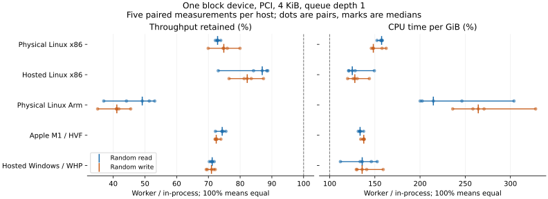

# Device isolation measurements — 2026-11-27

The milestone completed **300 successful boots**: 250 measured runs and 50
retained warm-ups, across five hosts and the follow-up controls. This measures
Dillo's current worker implementation against the same device code running in
the parent. It does not measure the cost of ALPC alone or establish a universal
cost for vhost-user.

The clearest result is a substantial cost for synchronous small I/O. One PCI
block worker retained 41–87% of in-process random-I/O throughput across the
measured hosts, and consumed more CPU per byte. Linux private host-memory growth
was small; Windows process startup and private commit were more noticeable.
Bulk/network results need more care and do not support one general overhead
percentage. No optimization or confinement change was made during this study.

## Method and provenance

The [plan](../../README.md) defines the comparison. Both modes use one release
executable built with `bench-in-process`, the same current device factories,
one vCPU, 256 MiB of guest RAM, and one unchanged guest image per case. The
console remains a worker in both modes. Only the block or user-network device
under measurement changes execution location. The control is compiled out of
normal builds and is not a second production backend implementation.

Each case has five AB/BA pairs following a retained warm-up pair. The cases are
one PCI block device, one MMIO block device, four PCI block devices, and PCI
user networking. Four-disk I/O is serial, not a saturation test. Block uses a
fully initialized, compressible `0x5a` 64 MiB raw file, guest O_DIRECT and queue
depth one; host caching remains enabled. Writes measure completion, not durable
storage. Network uses verified 64-byte and 64-KiB TCP echo exchanges with a
local server, excluding Internet/DNS variability. Rates count one payload per
round trip. Timed writes are read back outside the measurement interval.

| Host | Native backend | Timing per operation | Successful CI evidence |
| --- | --- | --- | --- |
| Physical EPYC 8324P, Linux x86 | KVM | 2 seconds | Local retained data |
| Hosted Xeon 6975P-C, Ubuntu | KVM | 1 second | [Linux job](https://github.com/pichi-vm/dillo/actions/runs/46004848323/job/140525322438) |
| CIX P1 CP8180, Linux Arm | KVM | 1 second | [Arm run](https://github.com/pichi-vm/dillo/actions/runs/46006419911) |
| Apple M1, macOS 26.5.1 | HVF | 1 second | [macOS run](https://github.com/pichi-vm/dillo/actions/runs/46006424373) |
| Hosted AMD x86, Windows Server 2025 | WHP / MSVC | 1 second | [Windows job](https://github.com/pichi-vm/dillo/actions/runs/46004848323/job/140525322427) |

Each host completed 48 boots. All use the pinned nightly-2026-07-06 compiler
and the existing immutable 6.1.155 guest-kernel assets. Source began at ALPC
revision `ba7fafc7a1598dab86e1afc61c250a55673deb48`. Benchmark Rust source is
`4e3035fadc6a7948f260553555557778f7a14ff3`; later native-run heads `8d4dcb8`
and observer-control head `0d190df` change Python/workflow/analysis only.
Their Cargo, Rust source and tests are identical. Binary/image hashes, exact
toolchains, OS versions and options are in the data.

The snuffler histogram unit check, strict snuffler Clippy checks, and Dillo boot
fixture Clippy checks passed. Release assets were built on every native lane.
The exported comparisons were checked against all five underlying paired
values; correctness assertions, timeouts and worker cleanup remain enabled.

The EPYC runs used CPUs 24–27 on a 64-logical-CPU host, with low recorded load
but no exclusive CPU reservation. Its kernel is a local development build;
the initial backing filesystem is btrfs. The CIX host reported eight CPUs and
load 2.82 at collection start. Hosted runners are virtualized evidence. Pairing
within a host limits variability; these hosts are not interchangeable samples
of an OS population. Five pairs provide observed spread, not a confidence
interval or a claim of statistical significance.

## Small block I/O

Absolute rates are medians in MiB/s. Ratios are medians of the five paired
worker/local ratios, which need not equal the ratio of the two absolute medians.

| Host, PCI | Read: local → worker | Read retained, pair range | Write: local → worker | Write retained, pair range |
| --- | --- | --- | --- | --- |
| Physical Linux x86 | 81.6 → 59.1 | 72.9%, 72.2–73.9% | 71.4 → 53.4 | 74.9%, 69.9–80.0% |
| Hosted Linux x86 | 86.2 → 75.6 | 87.0%, 73.1–88.7% | 81.1 → 67.5 | 82.2%, 76.5–87.4% |
| Physical Linux Arm | 155.4 → 79.8 | 49.1%, 37.0–53.1% | 171.4 → 70.3 | 41.1%, 35.1–45.5% |
| Apple M1 | 228.3 → 170.2 | 74.3%, 72.2–75.5% | 210.2 → 152.9 | 72.5%, 72.1–73.9% |
| Hosted Windows | 27.6 → 19.7 | 71.2%, 70.3–71.8% | 27.2 → 19.2 | 71.0%, 69.3–72.2% |

MMIO random-read/write retained throughput was respectively 88.6/89.4% on
physical Linux x86, 95.6/94.7% on hosted Linux x86, 65.8/65.1% on Linux Arm,
72.7/76.8% on M1, and 75.9/75.9% on Windows. This is consistent with a benefit
from KVM's directly exportable MMIO kick eventfd; it is not an isolated proof
of that mechanism's contribution.

The parent-plus-workers CPU cost per GiB of PCI random reads increased by
57.5%, 25.0%, 114.7%, 33.6%, and 36.0% in the table's host order. These are
sampled whole-process-tree CPU rates during each active phase, normalized by
completed bytes. They include VMM/guest execution accounting, not just backend
code. Windows CPU counters have more quantization and spread.

The PCI random-read p99 histogram upper bounds changed from 59.4 to 81.9 µs
on physical Linux x86, 69.6 to 77.8 µs on hosted Linux x86, 30.7 to 63.5 µs on
Linux Arm, and 24.6 to 31.7 µs on M1. Histogram rounding is at most 6.25%.
**Windows per-request percentiles are not usable:** the guest selected
`refined-jiffies`, producing many zero-duration samples and roughly 4-ms steps.
Its one-second throughput windows match observed host intervals (0.968–1.047 s
for PCI block, including 50-ms polling uncertainty). Do not interpret its
unchanged quantized p99 as unchanged latency. Host startup measurements also
remain preferable to comparing guest clock epochs across platforms.

## Bulk I/O and networking

Sequential 64-KiB PCI reads/writes retained 81.5/84.5% on physical Linux x86,
85.8/92.9% on hosted Linux x86, 70.0/74.6% on Linux Arm, 86.2/86.5% on M1,
and 81.4/81.7% on Windows. The physical x86 pairs were too variable for a
precise bulk estimate: read ratios ranged 68.6–128.6%, writes 52.9–165.6%.
The later controls below do not justify selecting a favorable subset.

| Host | 64-byte echo local → worker, MiB/s | Paired rate retained | 64-KiB echo local → worker, MiB/s | Paired rate retained |
| --- | --- | --- | --- | --- |
| Physical Linux x86 | 0.50 → 0.46 | 91.5% | 97.3 → 117.9 | 121.1% |
| Hosted Linux x86 | 0.71 → 0.74 | 103.6% | 15.9 → 45.5 | 307.9% |
| Physical Linux Arm | 0.63 → 0.41 | 69.3% | 8.32 → 4.82 | 58.2% |
| Apple M1 | 1.03 → 0.92 | 89.3% | 99.2 → 79.0 | 69.5% |
| Hosted Windows | 0.22 → 0.17 | 77.0% | 41.8 → 50.9 | 121.1% |

The bulk echo distribution has long stalls; the hosted Linux control, for
example, has a roughly 46-ms p99 despite sub-millisecond median calls. Changes
in stall frequency dominate its apparent worker improvement. The source uses
the same TCP stack, with different resource-creation paths and scheduling.
A delayed-ACK/Nagle interaction is a possible explanation, not an established
cause. These results do not establish that isolation improves network capacity,
nor do they measure unidirectional throughput or native bridge performance.

## Startup, threads and memory

The following are median **paired increments** for one/four PCI block devices.
Attachment time comes from existing VMM trace marks around attachment, not the
coarsely polled guest-ready marker. The console worker is present in the control.

| Host | Extra attachment time, 1 / 4 disks | Extra idle threads, 1 / 4 disks | Private-memory increase, 1 / 4 disks |
| --- | --- | --- | --- |
| Physical Linux x86 | 1.99 / 8.05 ms | 5 / 20 | 0.17 / 0.95 MiB private residency excluding hugetlb |
| Hosted Linux x86 | 1.31 / 5.07 ms | 5 / 20 | 0.16 / 1.10 MiB private residency excluding hugetlb |
| Physical Linux Arm | 2.25 / 8.99 ms | 5 / 20 | 0.33 / 1.34 MiB private residency excluding hugetlb |
| Apple M1 | 11.25 / 36.84 ms | 5 / 20 | Unavailable |
| Hosted Windows | 41.07 / 159.76 ms | 9 / 24 | 1.85 / 7.51 MiB private commit |

One disk changes the steady tree from two processes to three; four disks change
it from two to six. Windows thread counts include runtime/system helper threads
and can vary, so the increments need not scale linearly. Private commit is a
reservation/commit measure, not physical residency.

Every VM has **one 256-MiB guest backing allocation**, shared by its workers.
That is a configured extent, not a measured resident total, and is not multiplied
by process count. Summed RSS is never used as physical footprint. Linux PSS
excludes hugetlb pages; the summed non-hugetlb PSS increase for one/four disks is
0.34/1.47 MiB on physical x86, 0.52/1.62 MiB on hosted x86, and 0.39/1.54 MiB on
Arm. Raw USS misleadingly falls as formerly private guest pages become shared;
the host-private figures remove `Private_Hugetlb`. The [kernel documentation](https://www.kernel.org/doc/html/latest/filesystems/proc.html)
and [psutil definitions](https://psutil.readthedocs.io/stable/#psutil.Process.memory_full_info)
explain why these fields are not interchangeable.

The macOS detailed-memory calls failed while CPU/thread sampling succeeded;
1,696 failed memory queries are retained. Its missing USS is not evidence of
zero overhead. No permissions or signing entitlements were weakened to obtain
a number. None of these counters establishes a portable guest-plus-host
physical-memory total or accounts for every kernel allocation.

## Sensitivity and failures retained

- Linux sampling consumed about 2–3% of one core for one block device. With
  sampling disabled, PCI random-read/write ratios were 74.2/75.5%, consistent
  with the initial 72.9/74.9%. The additional five pairs use identical binaries.
- With tmpfs backing, ratios were 72.7/72.9%. With tmpfs plus `nokaslr`, they
  were 73.2/73.7%. Bulk-read spread persisted even in the latter (65.7–113.2%).
  This does not establish a filesystem or KASLR root cause for the bulk noise.
- Windows sampling cost about 6–9% of one core for one disk and more with four.
  A [separate same-runner control](https://github.com/pichi-vm/dillo/actions/runs/46007937517)
  ran five pairs with sampling on, then five off. Random-read retention was
  70.4% versus 70.7%; writes 70.4% versus 70.1%. The sampling work is real but
  does not explain the observed small-I/O penalty. This control does not prove
  zero instrumentation effect on every workload.
- The first pilots exposed empty loop devices and teardown being counted as
  steady state; those harness defects were fixed before the reported runs.
  Early CI setup failed on native Python availability, a Python-3.9 hash API,
  and assumptions about `sudo`. Later native runs passed; the original matrix
  remains red because of its superseded native setup jobs. Only the linked
  successful jobs/runs above are measurement evidence.
- Optional Linux `perf record` attempts for hardware cycles and software CPU
  clock were refused before launching a VM. No profiler permissions were
  changed. Consequently there is no sampled call-stack attribution in this
  report. The 300 successful boots exclude these failed profiler launches and
  the earlier pilots.

## Code and dependency footprint

The historical comparison is `5901733` (before the first worker change) to
`ba7fafc` (complete ALPC migration). It covers root runtime and `dillo-*` Rust
source/tests across all platforms. Counts include blank lines and comments,
separate test-gated items using Rust syntax, and are maintenance footprint—not
binary size or a measure of safety. Native C/header/build glue is separate.

| Category | Before | After | Increase |
| --- | --- | --- | --- |
| Runtime Rust physical lines | 31,752 | 38,660 | 6,908 |
| Test Rust physical lines | 20,180 | 23,132 | 2,952 |
| Windows channel C/header/build lines | 0 | 359 | 359 |
| Runtime Rust unsafe execution blocks | 98 | 152 | 54 |
| Runtime Rust unsafe functions | 5 | 20 | 15 |

The new worker/wire layer contains 2,018 runtime and 2,306 test lines; shared
Unix services contain 624 runtime and 187 test lines. The Windows channel has
747 Rust runtime, 218 test, and 359 native/build lines. Unsafe-site counts do
not compare the amount of unsafe work or account for safety inside dependencies
and C; tests add another 11 unsafe blocks and two unsafe functions.

The root lockfile adds twelve external package names: `ambient-authority`,
`cap-fs-ext`, `cap-primitives`, `cap-std`, `fs-set-times`, `io-extras`,
`io-lifetimes`, `ipnet`, `maybe-owned`, `rustix-linux-procfs`, `seccompiler`, and
`socket2`. This is the workspace graph, not twelve dependencies on every target.
The period also includes filesystem capability access, native confinement,
grant services, lifecycle fixes, queue fixes and interrupt reuse. Assigning all
growth to vhost-user or ALPC would be incorrect. The benchmark control itself
adds 69 lines across feature declarations and factory selection; it reuses the
existing backends. Guest probes and host analysis are separate benchmark code.

## What to investigate next

1. **Notification relays.** The worker writes a call notification; the parent
   waits in a relay and invokes the native interrupt. PCI also creates a local
   kick and bridges it when it cannot be exported, whereas KVM MMIO can export
   its eventfd. The extra threads and consistent small-I/O/CPU cost make this
   the strongest candidate. Test native notification integration on one path
   before generalizing; do not attribute the whole measured loss to it yet.
2. **Windows per-device startup.** One worker adds roughly 41 ms of attachment
   and 1.85 MiB of private commit here. Separate process/confinement/bootstrap
   costs before blaming ALPC or proposing shared workers.
3. **Network stalls.** Establish why bulk echo has long tails before using it
   to judge protocol efficiency. Keep networking measurements separate from
   block conclusions.

Shared-memory rings and kick/call signaling are protocol concepts. Dedicated
relay threads, per-device control readers, console configuration polling,
resource brokers, one process per device, and Dillo's confinement setup are
implementation choices. Control messages are not the block payload path.
These measurements do not impose the same costs on other spec adopters.

Filesystem, console and vsock throughput, multi-queue saturation, external
vhost-user servers and confidential-compute behavior were not measured. The
next milestone should target a demonstrated cost without weakening ownership
or changing the wire protocol by assumption. Execution pauses here for review.

## Reproduction and data

- [Overview CSV](overview.csv), [all comparisons and provenance](measurements.json.gz),
  [per-file source inventory](footprint.json.gz), [chart](block-cost.svg).
- CI run artifacts retain every console, error log, phase marker, guest report,
  and process sample. Artifact names are `device-benchmarks-PLATFORM`; the
  Windows observer artifact contains separate `on` and `off` directories.
- Local raw archive: `target/device-benchmarks-2026-11-27-raw.tar.gz` in this
  worktree. It includes all ten experiments, pilots and profiler refusals.
  Disposable disk/PMI files and executables are excluded; the asset fixture and
  recorded hashes identify how to reproduce them.
  SHA-256: `f1cfb072507c63637a42a4bb1502fcb0717ce47ad5227761d7fea0a32895f1d3`.
- The [measurement runner](../../run.py), [analysis](../../analyze.py),
  [plot](../../plot.py) and [source counter](../../footprint.py) retain the
  procedure. Linux controls add `--no-sample`, or `--backing-dir NEW_TMPFS_DIR`,
  then `--extra-cmdline nokaslr`. Their output directories and options are in
  the provenance. Windows observer control selects `cases=block-pci` and
  `sampling=both` in `benchmarks.yml`.
